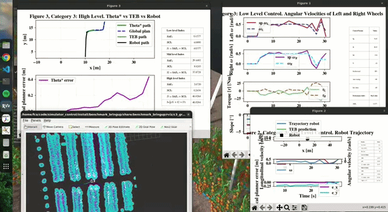
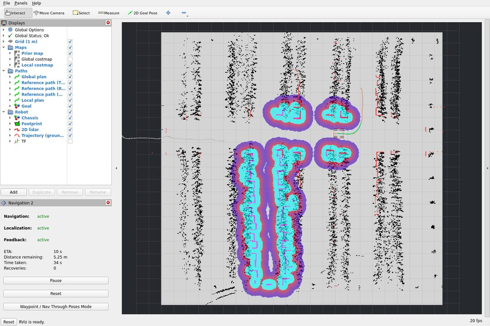
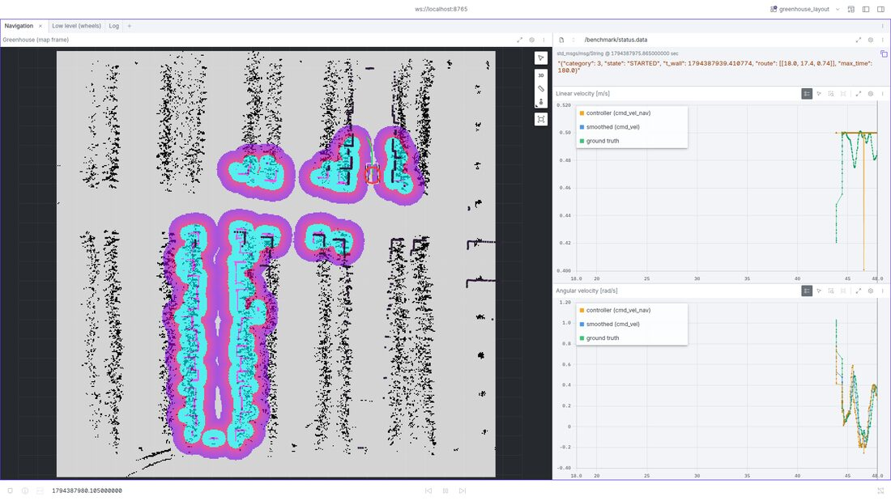

A ROS 2 Benchmarking Framework for Hierarchical Control Strategies in Mobile Robots for Mediterranean Greenhouses 🌱 
======================================
[](https://arxiv.org/abs/2602.15162)
[](.)
[](https://doi.org/10.5281/zenodo.24132939)
[](LICENSE)

This repository provides a standardised, reproducible benchmark for mobile robotics in greenhouse environments, designed to evaluate control laws and navigation algorithms under representative operating conditions. The framework combines a physics-based simulation of a real Mediterranean greenhouse (Agroconnect, Almería, Spain) with a hierarchical control architecture spanning low-, mid- and high-level control. Parameterised disturbances (payload, terrain type and slope), normalised performance indices, task-level indicators and a statistical protocol enable fair, repeatable comparisons of control strategies, while a plugin-based design allows custom controllers and planners to be integrated without modifying the benchmark. It used [MultiVehicle simulator (MVSim)](https://github.com/MRPT/mvsim), a lightweight dynamical simulator for 2D ("2.5D") vehicles that models wheel–ground contact forces and typical robot sensors, and [Navigation2 (Nav2) ](https://github.com/ros-navigation/navigation2?tab=readme-ov-file) for the mid- and high-level layers. The complete benchmark runs in real time using about two CPU cores (at most 2.3 cores of a 2017 desktop processor, Intel Core i7-8700), so it can be used on standard computers.



<!-- 
 -->

The simulator has been tested on ROS 2 Humble and Ubuntu 22.04 LTS. It can also be run on Windows and macOS by installing a [virtual machine](#virtual-machine).

> **Note:** Version v1.2.0 corresponds to the revised version of the associated article. Process tested on 11th November 2026.

📑 Unreleased: official MVSim
------------------

📑 What's new in v1.2.0
- The benchmark now uses the official [MVSim](https://github.com/MRPT/mvsim) (`develop` branch, built from source until its next release) instead of a fork. Its physics are those of current MVSim (friction circle, load transfer, gravity on slopes), with turn-slip compensation for skid-steer robots. **This is the version used in the revised article.** Version v1.1.0 (MVSim fork) is kept for reference.
- Terrain sectors are `PropertyRegion` elements of the world file that override, per wheel, the friction coefficient (`friction_mu`) and the rolling resistance (`friction_C_rr`). The damping `C_damping` is an internal friction of the wheel axle, so it is now the same in all the sectors.
- The low-level signals are read from the MVSim vehicle logs, published as ROS 2 topics (`/log/wheel_1/*`, `/log/pose/*`), instead of a custom `benchmark_msg` message.
- The seed (`seed:=N`) now also fixes the arrangement of the plants, so a run is fully reproducible from its seed.
- The skid-steer robot turns at the commanded rate: the MVSim `twist_pid` controller compensates the turn slip of the wheels, and the gain of the wheel PI is `KI = 200` (closed-loop poles -2.68 ± 2.68j s⁻¹, damping 0.71) instead of 40, whose slow pole made the robot take several seconds to reach the commanded turn rate.
- A Docker image with the complete benchmark is available (see [Docker](#docker)).
- Visualization: a new RViz configuration and a Foxglove layout. The Docker image includes RViz and foxglove_bridge: `GUI=1` also opens RViz (`WITHOUT_RVIZ=1` leaves it out) and `FOXGLOVE=1` starts the bridge. Locally, foxglove_bridge is started only if it is installed.
- New validity check of the runs: the median period of the ground-truth pose published by MVSim must not exceed 35 ms. On slow computers the simulator can keep a real-time factor of 1 while publishing the robot state (pose, odometry, TF) at a lower rate, which delays the feedback of the navigation stack.

📑 What's new in v1.1.0
------------------

- Alternative controllers and planners: besides the reference stack (PI + TEB + Lazy θ*), Category 2 can be run with MPPI and Regulated Pure Pursuit, and Category 3 with Smac Planner 2D and NavFn, selected with launch arguments. All the controllers share the same limits (0.5 m/s, 1.0 rad/s, 1.0 rad/s²).
- Common reference in Category 2: the four waypoints are joined into a fixed reference path that is sent directly to the controller (FollowPath), so every controller follows exactly the same reference.
- Redesigned metrics: time-averaged indices of normalised signals (SAE, SCI), relative indices with respect to the reference stack, and task-level indicators (success, time to goal, path length, clearance, contacts).
- Campaign tools: scripts to run complete campaigns with a real-time validity check and to compute the tables, heatmaps and statistical comparisons (tools/).
- Simulator fixes: odometry twist published by MVSim and lateral friction factor for skid-steer vehicles (MVSim fork; see above for the current version).
- Reference results: the 336 runs of the reference case are archived in [Zenodo](https://doi.org/10.5281/zenodo.22679881).

📑 Citation
------------------
*Paper citation*
------------------
```
@article{canadas2026ros2,
  title={A ROS 2 Benchmarking Framework for Hierarchical Control Strategies in Mobile Robots for Mediterranean Greenhouses},
  author={Ca{\~n}adas-Ar{\'a}nega, Fernando and Ma{\~n}as-{\'A}lvarez, Francisco J. and Guzmán, Jos{\'e} L. Moreno, Jos{\'e} C. and Blanco-Claraco, Jos{\'e} L.},
  journal={arXiv preprint arXiv:2602.15162},
  year={2026}
}
```
*Software citation*
------------------
```
@software{agricultural_benchmark,
  author  = {Ca{\~n}adas-Ar{\'a}nega, Fernando},
  title   = {A ROS 2 Benchmarking Framework for Hierarchical Control Strategies in Mobile Robots for Mediterranean Greenhouses},
  version = {1.2.0},
  year    = {2026},
  doi     = {10.5281/zenodo.24132939},
  url     = {https://github.com/FerCanAra/robotics_benchmark_greenhouse}
}
```
📜 License
--------------------
This project is distributed under the **BSD 3-Clause License**.

Copyright © 2026, Individual contributors  
Project owner: Fernando Cañadas Aránega <fernando.ca@ual.es> (University of Almeria) and collaborators

See the [LICENSE](LICENSE) file for full license text.

*International LICENCE: Intellectual property patent no. 2607246522198 held by [Safe Creative](https://www.safecreative.org/es)*


⚙️ Prerequisites
--------------------
In order to use the simulator, you must have the following packages installed:

1. [Robot Operating System (ROS 2) Humble](https://docs.ros.org/en/humble/Installation/Ubuntu-Install-Debs.html). It is recommended to install the full desktop.
2. [Navigation 2 (Nav2)](https://docs.nav2.org/getting_started/index.html). It is easily installed with the following command:
```
sudo apt install ros-$ROS_DISTRO-navigation2
sudo apt install ros-$ROS_DISTRO-nav2-bringup
```
3. Dependencies. The following dependencies are required::
```
sudo apt install git
sudo apt install python3-colcon-common-extensions
sudo apt install python3-rosdep2
```
4. [The Mobile Robot Programming Toolkit (MRPT)](https://docs.mrpt.org/reference/latest/download-mrpt.html). They will be installed in the rosdep commands.
5. [MVSim](https://github.com/MRPT/mvsim): until its next release includes `<random_seed>`, `<log_period>` and the turn slip compensation of `twist_pid`, clone its `develop` branch into the same workspace (`git clone https://github.com/MRPT/mvsim.git` in `~/ros2_ws/src`).

🛠️ Install and build
--------------------
In order to run the benchmark, the official project repository must be installed. This can be done easily using the following commands.

```
mkdir -p ~/ros2_ws/src
cd ~/ros2_ws/src
git clone --recurse-submodules https://github.com/FerCanAra/robotics_benchmark_greenhouse.git
cd robotics_benchmark_greenhouse
git submodule update --init --recursive
cd ../..
rosdep update
rosdep install --from-paths src -y --ignore-src
colcon build --symlink-install --cmake-args -DCMAKE_BUILD_TYPE=Release -DCMAKE_EXPORT_COMPILE_COMMANDS=ON
source install/setup.bash
```
To use exactly the version of the article, check out the release tag before building: git checkout v1.2.0 && git submodule update --recursive.

🚀 Usage
--------------------
The benchmark is structured according to a hierarchical control architecture with three levels. A new strategy can be evaluated at the level it targets while the other two levels remain fixed to the reference stack.

#### Control layers

1. **Low level (PI with anti-windup, Feedforward and Reference Filter)**: wheel-speed control of the motors, implemented inside the MVSim vehicle model [PID parameter](benchmark_bringup/benchmark_bringup/control_params/c1_pid_params.yaml) file. This layer is responsible for translating velocity commands into motor torques while accounting for realistic vehicle dynamics, including wheel–ground interactions. The low-level control scheme adopted in the benchmark is illustrated in the corresponding block diagram provided in the accompanying article.


2. **Mid-level (path following)**: Nav2 controller plugin. The reference controller is the [Timed Elastic Band (TEB-MPC)](https://github.com/FerCanAra/teb_local_planner_benchmark) local planner, managed through the Nav2 framework. The TEB-MPC module operates as a plugin-based component, allowing the user to fully replace or tune its [MPC parameters](benchmark_bringup/benchmark_bringup/control_params/c2_mpc_teb_params.yaml). This design supports the evaluation of different trajectory-following strategies under identical environmental and disturbance conditions. The mid-level control architecture is depicted in the corresponding control diagram.


3. **High-level (path planning):**: Nav2 planner plugin. The reference planner is [Lazzy Theta star](https://idm-lab.org/bib/abstracts/papers/aaai10b.pdf) global planner is employed and integrated via the Nav2 framework. All [planning parameters](benchmark_bringup/benchmark_bringup/control_params/c3_theta_start_params.yaml) can be modified, enabling users to analyze the impact of high-level planning decisions on overall navigation performance. The complete high-level control structure is presented in the associated schematic.


### Benchmark Categories

To support users with different expertise levels and research objectives, the benchmark defines three evaluation categories:

- **Category 1 (low level)**: a fixed sequence of velocity commands; evaluates wheel-speed tracking and control effort. Suitable for undergraduate courses on classical control.

- **Category 2 (low + mid level)**: the robot follows a fixed reference path through four waypoints, (10.2, 13.7), (15.0, 13.7), (18.0, 13.7) and (18.0, 17.4), along a corridor, the headland and a second corridor, without a global planner. Suitable for master-level studies on predictive control and path following.

- **Category 3 (low + mid + high level)**: autonomous navigation to a single goal, (18.0, 17.4) with a final orientation of 0.74 rad, using a global planner on a prior map. Suitable for doctoral research on planning and navigation.

In Categories 2 and 3, a run succeeds when the robot reaches the goal within 0.3 m before 180 s; otherwise it ends as failed (the controller aborts) or timeout.

### Disturbances

The three disturbances can be activated independently or combined (eight conditions):

- **Payload Sensitivity**: additional load from 0 to 70 kg, applied at the start of the simulation. It is not measured by any sensor; its value is declared by the user.

- **Terrain Slope**: a terrain profile with inclinations between approximately −4° (downhill) and +2.3° (uphill) along the reference path. Other profiles can be defined by modifying the terrain model of the world.

- **Terrain Change**: three soil sectors (gravel sand, concrete and compact sand), each with its own friction coefficient (μ) and rolling resistance coefficient (C_rr), defined with `PropertyRegion` elements in the world file.
  

### Running

All these variables can be launched with the following command:

```
ros2 launch benchmark_bringup launch_benchmark_bringup.launch.py \
  category:=2 \
  controller:=teb \
  planner:=theta \
  payload:=0 \
  terrain_slope:=false \
  change_terrain:=false \
  seed:=1
```
where:

- ```category:=1 ``` selects the evaluation category (1, 2, or 3),

- ```controller:=teb ``` selects the mid-level controller (teb, mppi, rpp or dwb; Categories 2 and 3),

- ```planner```  selects the global planner (theta, smac or navfn; Category 3),

- ```payload``` specifies the additional load (from 0 to 70 kg),

- ```terrain_slope:=false ``` enables or disables terrain inclination (true or false),

- ```change_terrain:=false ``` change_terrain enables or disables terrain heterogeneity (true or false).

The launch file applies the common limits to whichever controller is selected, so that all of them are evaluated under the same conditions.

Example:

[Benchmark category 3 demo](https://youtu.be/-QOWn2Ga2w0)

For a complete description of the simulator architecture, control schemes, evaluation metrics, and experimental methodology, the reader is referred to the associated journal/conference article, which provides a detailed and rigorous explanation of the benchmark framework.


🖥️ Visualization
--------------------
During a run, the MVSim window shows the 3D view of the greenhouse and the real-time plots show the signals of each level. In Categories 2 and 3, RViz shows the prior map, the local costmap, the global plan, the reference path of the controller, the local plan, the lidar scan and the trajectory of the robot. [Foxglove](https://foxglove.dev/) shows the same scene together with the velocity commands, the wheel signals of the low-level controller and the ROS log.





The visualization is optional: `use_rviz:=False` disables RViz (Categories 2 and 3, with the configuration in [`rviz/greenhouse.rviz`](benchmark_bringup/benchmark_bringup/rviz/greenhouse.rviz)), `plot:=False` the real-time plots and `headless:=True` the MVSim window. If [foxglove_bridge](https://docs.foxglove.dev/docs/visualization/ros-foxglove-bridge) is installed (`sudo apt install ros-$ROS_DISTRO-foxglove-bridge`), it is also started (port `foxglove_port:=8765`; `use_foxglove:=False` disables it), and [Foxglove](https://foxglove.dev/) can show the run with the layout in [`foxglove/greenhouse_layout.json`](benchmark_bringup/benchmark_bringup/foxglove/greenhouse_layout.json). Without the package, the benchmark runs without it.


📊 Metrics and Data Logging
--------------------
During a run, real-time plots show the errors and control effort of each level. When the run finishes, a folder is created with the time series (CSV), the performance indices and the run metadata (seed, condition, configuration and final status) in ```$pwd/result/category_X/yyyy_mm_dd_hh_mm_ss.csv```). The indices are time averages of normalised signals, so they do not depend on the sampling frequency or the duration of the test:

- SAE (Scaled Absolute Error): mean normalised tracking error of the evaluated level (wheel velocity error in Category 1; distance to the common reference path in Category 2; distance to the first plan in Category 3).
- SCI (Scaled Control Input): mean normalised control input (motor torque or velocity command), bounded between 0 and 1.
J = (SAE + SCI)/2 for each level, and J<sup>rel</sup>, relative to the reference stack in the nominal condition (1 = reference, < 1 better).
- Task-level indicators (Categories 2 and 3): success, time to goal, path length (and planned length in Category 3), minimum distance to the obstacles and number of contacts.

Since a controller that slows down reduces its control effort, the indices should always be read together with the success rate and the time to goal. See the article for the complete definitions.

🔬 Reproducing the results
--------------------
The ```tools/``` directory contains the scripts used for the reference case:
```
cd ~/ros2_ws/src/robotics_benchmark_greenhouse/benchmark_bringup/benchmark_bringup/tools
python3 run_batch.py --out ~/results --categories 2 \
    --controllers teb mppi rpp --conditions all --seeds 6
python3 analyze_results.py ~/results
```
- **run_batch.py** runs a complete campaign without visualisation (any subset of categories, controllers, planners, conditions and seeds), checks the validity of every run (real-time factor within 1 ± 0.05, no gap longer than 0.5 s in the recorded data and, in Categories 2 and 3, no more than 5 % of missed control cycles of the mid-level controller and a median period of the ground-truth pose published by MVSim not longer than 35 ms), repeats invalid runs and resumes interrupted campaigns.
- **analyze_results.py** computes the indices, the tables (mean ± standard deviation and Mann–Whitney comparisons with the baseline), the heatmaps of the relative indices and the computational cost.

The reference case comprises 336 valid runs (8 conditions × 6 runs; PI in Category 1, three controllers in Category 2 and three planners in Category 3). The individual results of every run are available in Zenodo.

🐳 Docker <a name="docker"></a>
--------------------
The Docker image contains the complete benchmark (ROS 2 Humble, Nav2, MRPT, MVSim and this repository), so a campaign can be reproduced without installing anything else. It is published in the GitHub Container Registry, and the exact image used for the results of the article is archived in Zenodo.

Step by step, on a fresh Ubuntu computer:

1. Install Docker (only once), and add your user to the `docker` group (log out and in again afterwards):
   ```
   curl -fsSL https://get.docker.com | sh
   sudo usermod -aG docker $USER
   ```
2. Only for NVIDIA GPUs, with the NVIDIA driver already installed (`nvidia-smi` must work): install the NVIDIA Container Toolkit (only once). Intel/AMD GPUs do not need this step.
   ```
   curl -fsSL https://nvidia.github.io/libnvidia-container/gpgkey | sudo gpg --dearmor -o /usr/share/keyrings/nvidia-container-toolkit-keyring.gpg
   curl -s -L https://nvidia.github.io/libnvidia-container/stable/deb/nvidia-container-toolkit.list | \
     sed 's#deb https://#deb [signed-by=/usr/share/keyrings/nvidia-container-toolkit-keyring.gpg] https://#g' | \
     sudo tee /etc/apt/sources.list.d/nvidia-container-toolkit.list
   sudo apt update && sudo apt install -y nvidia-container-toolkit
   sudo nvidia-ctk runtime configure --runtime=docker && sudo systemctl restart docker
   ```
3. Download the image, either the latest build of `main` or the one of a given commit:
   ```
   docker pull ghcr.io/fercanara/robotics_benchmark_greenhouse:latest
   # or: docker pull ghcr.io/fercanara/robotics_benchmark_greenhouse:sha-<commit>
   ```
4. Clone this repository (only `docker/run_campaign.sh` is needed to run the image):
   ```
   git clone https://github.com/FerCanAra/robotics_benchmark_greenhouse.git
   cd robotics_benchmark_greenhouse
   ```
5. Run a campaign, e.g. a single run without GUI, or with the MVSim window and the real-time plots:
   ```
   docker/run_campaign.sh ~/results --categories 3 --planners theta --controllers teb --conditions nominal --seeds 1

   xhost +local:
   GUI=1 docker/run_campaign.sh ~/results_gui --categories 3 --planners theta --controllers teb --conditions nominal --seeds 1
   ```
   A complete campaign, e.g. for Category 2: `docker/run_campaign.sh ~/results --categories 2 --controllers teb mppi rpp --conditions all --seeds 6`. Each run writes its log in `RESULTS_DIR/logs/`, and `RESULTS_DIR/batch_log.csv` summarizes the status and the real-time factor of every run.

`run_campaign.sh` runs `run_batch.py` inside the container, with the same arguments, and writes the results in the given folder (`IMAGE=...` selects another image). The image archived in Zenodo is loaded with `docker load -i <file>.tar.gz`.

- **GPU**: MVSim renders the sensors with OpenGL. Without GPU access the simulation runs much slower than real time and the validity check rejects every run. `run_campaign.sh` gives the container access to an NVIDIA GPU (it requires the [NVIDIA Container Toolkit](https://docs.nvidia.com/datacenter/cloud-native/container-toolkit/latest/install-guide.html)) or to `/dev/dri` (Intel/AMD), adding the container user to the groups that own the devices.
- **Network**: MVSim downloads the 3D models and textures of the world from `mrpt.github.io` at the start of every run. If MVSim stays in "Loading the world..." and the log of the run shows `Error (code=4) running wget`, the container cannot resolve names: Docker copies the upstream DNS servers of the host, and glibc only uses the first three, so stale entries (e.g. from a disconnected VPN) break it even if the host works. Check with `docker run --rm alpine nslookup mrpt.github.io`, and fix the DNS configuration of the host or set `"dns"` in `/etc/docker/daemon.json`.
- **CPU**: every run must keep real time, so do not run other heavy processes during a campaign; invalid runs are repeated automatically. The MVSim main loop runs on a single core, so the single-thread performance of the CPU matters: if most runs are rejected for the period of the ground-truth pose, the computer is too slow for the benchmark. On laptops, check that the power profile is not limiting the CPU frequency (`powerprofilesctl get` should not show `power-saver`; set it with `powerprofilesctl set performance`), and keep the computer plugged in.
- **GUI**: the runs are headless by default. To watch the MVSim 3D view, the real-time plots of each level and RViz, allow local containers to open windows and set `GUI=1` (add `WITHOUT_RVIZ=1` to leave RViz out):
  ```
  xhost +local:
  GUI=1 docker/run_campaign.sh ~/results_gui --categories 3 --planners theta --conditions nominal --seeds 1
  GUI=1 WITHOUT_RVIZ=1 docker/run_campaign.sh ~/results_gui --categories 3 --planners theta --conditions nominal --seeds 1
  ```
  `GUI=1` shares the X server of the desktop with the container (`DISPLAY` and `/tmp/.X11-unix`) and passes `headless:=False`, `plot:=True` and `use_rviz:=True` to the runs (RViz is only used in Categories 2 and 3). Without the script, add `-e DISPLAY=$DISPLAY -e QT_X11_NO_MITSHM=1 -v /tmp/.X11-unix:/tmp/.X11-unix:ro` to `docker run`, and `--arg headless:=False --arg plot:=True --arg use_rviz:=True` to `run_batch.py`. Drawing the windows adds load to the computer, so keep these runs out of the folders of the campaigns. `xhost -local:` revokes the access when done.
- **Foxglove**: the image includes [foxglove_bridge](https://docs.foxglove.dev/docs/visualization/ros-foxglove-bridge). With `FOXGLOVE=1`, the runs start it and its port is published on the host, so [Foxglove](https://foxglove.dev/) can connect to `ws://localhost:8765` (another port with `FOXGLOVE_PORT=...`); it works with or without `GUI=1`, e.g. on a remote computer. A layout for the benchmark is in [`foxglove/greenhouse_layout.json`](benchmark_bringup/benchmark_bringup/foxglove/greenhouse_layout.json) (Layouts, Import from file).
- **Building the image**: `docker build -f docker/Dockerfile -t greenhouse-benchmark .` from the repository root, with its submodules checked out. The MVSim version is set with `--build-arg MVSIM_REF=<tag or commit>`.

🧩 Evaluating your own control law
--------------------

- Low level: modify or replace the control function in ```VehicleDifferential_ControllerTwistPID.cpp``` (inputs: wheel velocity reference and measurement, estimated slope torque; output: motor torque).
- Mid level: write a configuration file for any existing Nav2 controller, or develop a new controller plugin [tutorial](https://docs.nav2.org/rolling/tutorials/plugin_tutorials/writing_new_controller_plugin/writing_new_controller_plugin/), and add it to the list of controllers of the launch file.
- High level: configure any Nav2 planner or develop a new planner plugin [tutorial](https://docs.nav2.org/rolling/tutorials/plugin_tutorials/writing_new_planner_plugin/writing_new_planner_plugin/), and add it to the list of planners of the launch file.

Then run the same campaign with run_batch.py and compare with the reference results.


🖥️ Virtual Machine <a name="virtual-machine"></a>
--------------------
A fully configured virtual machine is provided to ensure easy deployment and reproducibility across different operating systems (Windows and IOS). To set up this virtual machine, follow these [instructions](https://github.com/FerCanAra/IIR_ROS2_Tutorial/blob/main/docs/vmwaresetup.md). They first detail how to install VMware Pro 17 for free on Ubuntu 22.04, followed by configuring the ROS 2 Humble environment and installing the benchmark.


<div align="center">

# MultiVehicle Simulator (MVSim)


**Lightweight, realistic 2.5D dynamics simulator for mobile robots and multi-agent research**

[](https://github.com/MRPT/mvsim/actions/workflows/build-linux.yml) [](https://github.com/MRPT/mvsim/actions/workflows/check-clang-format.yml) [](https://mvsimulator.readthedocs.io/en/latest/?badge=latest) [](LICENSE)

[**Documentation**](https://mvsimulator.readthedocs.io) · [**Installation**](https://mvsimulator.readthedocs.io/en/latest/install.html) · [**Demo worlds**](https://mvsimulator.readthedocs.io/en/latest/demo_worlds.html) · [**Cite**](#citation)

</div>

<div align="center">
  
# Navigation2 (Nav2)


</div>

| Package | humble Source | humble Debian | jazzy Source | jazzy Debian | kilted Source | kilted Debian |
| :---: | :---: | :---: | :---: | :---: | :---: | :---: |
| navigation2 | [](https://build.ros2.org/job/Hsrc_uj__navigation2__ubuntu_jammy__source/) | [](https://build.ros2.org/job/Hbin_uj64__navigation2__ubuntu_jammy_amd64__binary/) | [](https://build.ros2.org/job/Jsrc_un__navigation2__ubuntu_noble__source/) | [](https://build.ros2.org/job/Jbin_un64__navigation2__ubuntu_noble_amd64__binary/) | [](https://build.ros2.org/job/Ksrc_un__navigation2__ubuntu_noble__source/) | [](https://build.ros2.org/job/Kbin_un64__navigation2__ubuntu_noble_amd64__binary/) |
| nav2_amcl | [](https://build.ros2.org/job/Hsrc_uj__nav2_amcl__ubuntu_jammy__source/) | [](https://build.ros2.org/job/Hbin_uj64__nav2_amcl__ubuntu_jammy_amd64__binary/) | [](https://build.ros2.org/job/Jsrc_un__nav2_amcl__ubuntu_noble__source/) | [](https://build.ros2.org/job/Jbin_un64__nav2_amcl__ubuntu_noble_amd64__binary/) | [](https://build.ros2.org/job/Ksrc_un__nav2_amcl__ubuntu_noble__source/) | [](https://build.ros2.org/job/Kbin_un64__nav2_amcl__ubuntu_noble_amd64__binary/) |
| nav2_behavior_tree | [](https://build.ros2.org/job/Hsrc_uj__nav2_behavior_tree__ubuntu_jammy__source/) | [](https://build.ros2.org/job/Hbin_uj64__nav2_behavior_tree__ubuntu_jammy_amd64__binary/) | [](https://build.ros2.org/job/Jsrc_un__nav2_behavior_tree__ubuntu_noble__source/) | [](https://build.ros2.org/job/Jbin_un64__nav2_behavior_tree__ubuntu_noble_amd64__binary/) | [](https://build.ros2.org/job/Ksrc_un__nav2_behavior_tree__ubuntu_noble__source/) | [](https://build.ros2.org/job/Kbin_un64__nav2_behavior_tree__ubuntu_noble_amd64__binary/) |
| nav2_behaviors | [](https://build.ros2.org/job/Hsrc_uj__nav2_behaviors__ubuntu_jammy__source/) | [](https://build.ros2.org/job/Hbin_uj64__nav2_behaviors__ubuntu_jammy_amd64__binary/) | [](https://build.ros2.org/job/Jsrc_un__nav2_behaviors__ubuntu_noble__source/) | [](https://build.ros2.org/job/Jbin_un64__nav2_behaviors__ubuntu_noble_amd64__binary/) | [](https://build.ros2.org/job/Ksrc_un__nav2_behaviors__ubuntu_noble__source/) | [](https://build.ros2.org/job/Kbin_un64__nav2_behaviors__ubuntu_noble_amd64__binary/) |
| nav2_bringup | [](https://build.ros2.org/job/Hsrc_uj__nav2_bringup__ubuntu_jammy__source/) | [](https://build.ros2.org/job/Hbin_uj64__nav2_bringup__ubuntu_jammy_amd64__binary/) | [](https://build.ros2.org/job/Jsrc_un__nav2_bringup__ubuntu_noble__source/) | [](https://build.ros2.org/job/Jbin_un64__nav2_bringup__ubuntu_noble_amd64__binary/) | [](https://build.ros2.org/job/Ksrc_un__nav2_bringup__ubuntu_noble__source/) | [](https://build.ros2.org/job/Kbin_un64__nav2_bringup__ubuntu_noble_amd64__binary/) |
| nav2_bt_navigator | [](https://build.ros2.org/job/Hsrc_uj__nav2_bt_navigator__ubuntu_jammy__source/) | [](https://build.ros2.org/job/Hbin_uj64__nav2_bt_navigator__ubuntu_jammy_amd64__binary/) | [](https://build.ros2.org/job/Jsrc_un__nav2_bt_navigator__ubuntu_noble__source/) | [](https://build.ros2.org/job/Jbin_un64__nav2_bt_navigator__ubuntu_noble_amd64__binary/) | [](https://build.ros2.org/job/Ksrc_un__nav2_bt_navigator__ubuntu_noble__source/) | [](https://build.ros2.org/job/Kbin_un64__nav2_bt_navigator__ubuntu_noble_amd64__binary/) |
| nav2_collision_monitor | [](https://build.ros2.org/job/Hsrc_uj__nav2_collision_monitor__ubuntu_jammy__source/) | [](https://build.ros2.org/job/Hbin_uj64__nav2_collision_monitor__ubuntu_jammy_amd64__binary/) | [](https://build.ros2.org/job/Jsrc_un__nav2_collision_monitor__ubuntu_noble__source/) | [](https://build.ros2.org/job/Jbin_un64__nav2_collision_monitor__ubuntu_noble_amd64__binary/) | [](https://build.ros2.org/job/Ksrc_un__nav2_collision_monitor__ubuntu_noble__source/) | [](https://build.ros2.org/job/Kbin_un64__nav2_collision_monitor__ubuntu_noble_amd64__binary/) |
| nav2_common | [](https://build.ros2.org/job/Hsrc_uj__nav2_common__ubuntu_jammy__source/) | [](https://build.ros2.org/job/Hbin_uj64__nav2_common__ubuntu_jammy_amd64__binary/) | [](https://build.ros2.org/job/Jsrc_un__nav2_common__ubuntu_noble__source/) | [](https://build.ros2.org/job/Jbin_un64__nav2_common__ubuntu_noble_amd64__binary/) | [](https://build.ros2.org/job/Ksrc_un__nav2_common__ubuntu_noble__source/) | [](https://build.ros2.org/job/Kbin_un64__nav2_common__ubuntu_noble_amd64__binary/) |
| nav2_constrained_smoother | [](https://build.ros2.org/job/Hsrc_uj__nav2_constrained_smoother__ubuntu_jammy__source/) | [](https://build.ros2.org/job/Hbin_uj64__nav2_constrained_smoother__ubuntu_jammy_amd64__binary/) | [](https://build.ros2.org/job/Jsrc_un__nav2_constrained_smoother__ubuntu_noble__source/) | [](https://build.ros2.org/job/Jbin_un64__nav2_constrained_smoother__ubuntu_noble_amd64__binary/) | [](https://build.ros2.org/job/Ksrc_un__nav2_constrained_smoother__ubuntu_noble__source/) | [](https://build.ros2.org/job/Kbin_un64__nav2_constrained_smoother__ubuntu_noble_amd64__binary/) |
| nav2_controller | [](https://build.ros2.org/job/Hsrc_uj__nav2_controller__ubuntu_jammy__source/) | [](https://build.ros2.org/job/Hbin_uj64__nav2_controller__ubuntu_jammy_amd64__binary/) | [](https://build.ros2.org/job/Jsrc_un__nav2_controller__ubuntu_noble__source/) | [](https://build.ros2.org/job/Jbin_un64__nav2_controller__ubuntu_noble_amd64__binary/) | [](https://build.ros2.org/job/Ksrc_un__nav2_controller__ubuntu_noble__source/) | [](https://build.ros2.org/job/Kbin_un64__nav2_controller__ubuntu_noble_amd64__binary/) |
| nav2_core | [](https://build.ros2.org/job/Hsrc_uj__nav2_core__ubuntu_jammy__source/) | [](https://build.ros2.org/job/Hbin_uj64__nav2_core__ubuntu_jammy_amd64__binary/) | [](https://build.ros2.org/job/Jsrc_un__nav2_core__ubuntu_noble__source/) | [](https://build.ros2.org/job/Jbin_un64__nav2_core__ubuntu_noble_amd64__binary/) | [](https://build.ros2.org/job/Ksrc_un__nav2_core__ubuntu_noble__source/) | [](https://build.ros2.org/job/Kbin_un64__nav2_core__ubuntu_noble_amd64__binary/) |
| nav2_costmap_2d | [](https://build.ros2.org/job/Hsrc_uj__nav2_costmap_2d__ubuntu_jammy__source/) | [](https://build.ros2.org/job/Hbin_uj64__nav2_costmap_2d__ubuntu_jammy_amd64__binary/) | [](https://build.ros2.org/job/Jsrc_un__nav2_costmap_2d__ubuntu_noble__source/) | [](https://build.ros2.org/job/Jbin_un64__nav2_costmap_2d__ubuntu_noble_amd64__binary/) | [](https://build.ros2.org/job/Ksrc_un__nav2_costmap_2d__ubuntu_noble__source/) | [](https://build.ros2.org/job/Kbin_un64__nav2_costmap_2d__ubuntu_noble_amd64__binary/) |
| nav2_docking | [](https://build.ros2.org/job/Hsrc_uj__opennav_docking__ubuntu_jammy__source/) | [](https://build.ros2.org/job/Hbin_uj64__opennav_docking__ubuntu_jammy_amd64__binary/) | [](https://build.ros2.org/job/Jsrc_un__opennav_docking__ubuntu_noble__source/) | [](https://build.ros2.org/job/Jbin_un64__opennav_docking__ubuntu_noble_amd64__binary/) | [](https://build.ros2.org/job/Ksrc_un__opennav_docking__ubuntu_noble__source/) | [](https://build.ros2.org/job/Kbin_un64__opennav_docking__ubuntu_noble_amd64__binary/) |
| nav2_dwb_controller | [](https://build.ros2.org/job/Hsrc_uj__nav2_dwb_controller__ubuntu_jammy__source/) | [](https://build.ros2.org/job/Hbin_uj64__nav2_dwb_controller__ubuntu_jammy_amd64__binary/) | [](https://build.ros2.org/job/Jsrc_un__nav2_dwb_controller__ubuntu_noble__source/) | [](https://build.ros2.org/job/Jbin_un64__nav2_dwb_controller__ubuntu_noble_amd64__binary/) | [](https://build.ros2.org/job/Ksrc_un__nav2_dwb_controller__ubuntu_noble__source/) | [](https://build.ros2.org/job/Kbin_un64__nav2_dwb_controller__ubuntu_noble_amd64__binary/) |
| nav2_graceful_controller | [](https://build.ros2.org/job/Hsrc_uj__nav2_graceful_controller__ubuntu_jammy__source/) | [](https://build.ros2.org/job/Hbin_uj64__nav2_graceful_controller__ubuntu_jammy_amd64__binary/) | [](https://build.ros2.org/job/Jsrc_un__nav2_graceful_controller__ubuntu_noble__source/) | [](https://build.ros2.org/job/Jbin_un64__nav2_graceful_controller__ubuntu_noble_amd64__binary/) | [](https://build.ros2.org/job/Ksrc_un__nav2_graceful_controller__ubuntu_noble__source/) | [](https://build.ros2.org/job/Kbin_un64__nav2_graceful_controller__ubuntu_noble_amd64__binary/) |
| nav2_lifecycle_manager | [](https://build.ros2.org/job/Hsrc_uj__nav2_lifecycle_manager__ubuntu_jammy__source/) | [](https://build.ros2.org/job/Hbin_uj64__nav2_lifecycle_manager__ubuntu_jammy_amd64__binary/) | [](https://build.ros2.org/job/Jsrc_un__nav2_lifecycle_manager__ubuntu_noble__source/) | [](https://build.ros2.org/job/Jbin_un64__nav2_lifecycle_manager__ubuntu_noble_amd64__binary/) | [](https://build.ros2.org/job/Ksrc_un__nav2_lifecycle_manager__ubuntu_noble__source/) | [](https://build.ros2.org/job/Kbin_un64__nav2_lifecycle_manager__ubuntu_noble_amd64__binary/) |
| nav2_loopback_sim | N/A | N/A | [](https://build.ros2.org/job/Jsrc_un__nav2_loopback_sim__ubuntu_noble__source/) | [](https://build.ros2.org/job/Jbin_un64__nav2_loopback_sim__ubuntu_noble_amd64__binary/) | [](https://build.ros2.org/job/Ksrc_un__nav2_loopback_sim__ubuntu_noble__source/) | [](https://build.ros2.org/job/Kbin_un64__nav2_loopback_sim__ubuntu_noble_amd64__binary/) |
| nav2_map_server | [](https://build.ros2.org/job/Hsrc_uj__nav2_map_server__ubuntu_jammy__source/) | [](https://build.ros2.org/job/Hbin_uj64__nav2_map_server__ubuntu_jammy_amd64__binary/) | [](https://build.ros2.org/job/Jsrc_un__nav2_map_server__ubuntu_noble__source/) | [](https://build.ros2.org/job/Jbin_un64__nav2_map_server__ubuntu_noble_amd64__binary/) | [](https://build.ros2.org/job/Ksrc_un__nav2_map_server__ubuntu_noble__source/) | [](https://build.ros2.org/job/Kbin_un64__nav2_map_server__ubuntu_noble_amd64__binary/) |
| nav2_mppi_controller | [](https://build.ros2.org/job/Hsrc_uj__nav2_mppi_controller__ubuntu_jammy__source/) | [](https://build.ros2.org/job/Hbin_uj64__nav2_mppi_controller__ubuntu_jammy_amd64__binary/) | [](https://build.ros2.org/job/Jsrc_un__nav2_mppi_controller__ubuntu_noble__source/) | [](https://build.ros2.org/job/Jbin_un64__nav2_mppi_controller__ubuntu_noble_amd64__binary/) | [](https://build.ros2.org/job/Ksrc_un__nav2_mppi_controller__ubuntu_noble__source/) | [](https://build.ros2.org/job/Kbin_un64__nav2_mppi_controller__ubuntu_noble_amd64__binary/) |
| nav2_msgs | [](https://build.ros2.org/job/Hsrc_uj__nav2_msgs__ubuntu_jammy__source/) | [](https://build.ros2.org/job/Hbin_uj64__nav2_msgs__ubuntu_jammy_amd64__binary/) | [](https://build.ros2.org/job/Jsrc_un__nav2_msgs__ubuntu_noble__source/) | [](https://build.ros2.org/job/Jbin_un64__nav2_msgs__ubuntu_noble_amd64__binary/) | [](https://build.ros2.org/job/Ksrc_un__nav2_msgs__ubuntu_noble__source/) | [](https://build.ros2.org/job/Kbin_un64__nav2_msgs__ubuntu_noble_amd64__binary/) |
| nav2_navfn_planner | [](https://build.ros2.org/job/Hsrc_uj__nav2_navfn_planner__ubuntu_jammy__source/) | [](https://build.ros2.org/job/Hbin_uj64__nav2_navfn_planner__ubuntu_jammy_amd64__binary/) | [](https://build.ros2.org/job/Jsrc_un__nav2_navfn_planner__ubuntu_noble__source/) | [](https://build.ros2.org/job/Jbin_un64__nav2_navfn_planner__ubuntu_noble_amd64__binary/) | [](https://build.ros2.org/job/Ksrc_un__nav2_navfn_planner__ubuntu_noble__source/) | [](https://build.ros2.org/job/Kbin_un64__nav2_navfn_planner__ubuntu_noble_amd64__binary/) |
| nav2_planner | [](https://build.ros2.org/job/Hsrc_uj__nav2_planner__ubuntu_jammy__source/) | [](https://build.ros2.org/job/Hbin_uj64__nav2_planner__ubuntu_jammy_amd64__binary/) | [](https://build.ros2.org/job/Jsrc_un__nav2_planner__ubuntu_noble__source/) | [](https://build.ros2.org/job/Jbin_un64__nav2_planner__ubuntu_noble_amd64__binary/) | [](https://build.ros2.org/job/Ksrc_un__nav2_planner__ubuntu_noble__source/) | [](https://build.ros2.org/job/Kbin_un64__nav2_planner__ubuntu_noble_amd64__binary/) |
| nav2_regulated_pure_pursuit | [](https://build.ros2.org/job/Hsrc_uj__nav2_regulated_pure_pursuit_controller__ubuntu_jammy__source/) | [](https://build.ros2.org/job/Hbin_uj64__nav2_regulated_pure_pursuit_controller__ubuntu_jammy_amd64__binary/) | [](https://build.ros2.org/job/Jsrc_un__nav2_regulated_pure_pursuit_controller__ubuntu_noble__source/) | [](https://build.ros2.org/job/Jbin_un64__nav2_regulated_pure_pursuit_controller__ubuntu_noble_amd64__binary/) | [](https://build.ros2.org/job/Ksrc_un__nav2_regulated_pure_pursuit_controller__ubuntu_noble__source/) | [](https://build.ros2.org/job/Kbin_un64__nav2_regulated_pure_pursuit_controller__ubuntu_noble_amd64__binary/) |
| nav2_rotation_shim_controller | [](https://build.ros2.org/job/Hsrc_uj__nav2_rotation_shim_controller__ubuntu_jammy__source/) | [](https://build.ros2.org/job/Hbin_uj64__nav2_rotation_shim_controller__ubuntu_jammy_amd64__binary/) | [](https://build.ros2.org/job/Jsrc_un__nav2_rotation_shim_controller__ubuntu_noble__source/) | [](https://build.ros2.org/job/Jbin_un64__nav2_rotation_shim_controller__ubuntu_noble_amd64__binary/) | [](https://build.ros2.org/job/Ksrc_un__nav2_rotation_shim_controller__ubuntu_noble__source/) | [](https://build.ros2.org/job/Kbin_un64__nav2_rotation_shim_controller__ubuntu_noble_amd64__binary/) |
| nav2_route | N/A | N/A | N/A | N/A | [](https://build.ros2.org/job/Ksrc_un__nav2_route__ubuntu_noble__source/) | [](https://build.ros2.org/job/Kbin_un64__nav2_route__ubuntu_noble_amd64__binary/) |
| nav2_rviz_plugins | [](https://build.ros2.org/job/Hsrc_uj__nav2_rviz_plugins__ubuntu_jammy__source/) | [](https://build.ros2.org/job/Hbin_uj64__nav2_rviz_plugins__ubuntu_jammy_amd64__binary/) | [](https://build.ros2.org/job/Jsrc_un__nav2_rviz_plugins__ubuntu_noble__source/) | [](https://build.ros2.org/job/Jbin_un64__nav2_rviz_plugins__ubuntu_noble_amd64__binary/) | [](https://build.ros2.org/job/Ksrc_un__nav2_rviz_plugins__ubuntu_noble__source/) | [](https://build.ros2.org/job/Kbin_un64__nav2_rviz_plugins__ubuntu_noble_amd64__binary/) |
| nav2_simple_commander | [](https://build.ros2.org/job/Hsrc_uj__nav2_simple_commander__ubuntu_jammy__source/) | [](https://build.ros2.org/job/Hbin_uj64__nav2_simple_commander__ubuntu_jammy_amd64__binary/) | [](https://build.ros2.org/job/Jsrc_un__nav2_simple_commander__ubuntu_noble__source/) | [](https://build.ros2.org/job/Jbin_un64__nav2_simple_commander__ubuntu_noble_amd64__binary/) | [](https://build.ros2.org/job/Ksrc_un__nav2_simple_commander__ubuntu_noble__source/) | [](https://build.ros2.org/job/Kbin_un64__nav2_simple_commander__ubuntu_noble_amd64__binary/) |
| nav2_smac_planner | [](https://build.ros2.org/job/Hsrc_uj__nav2_smac_planner__ubuntu_jammy__source/) | [](https://build.ros2.org/job/Hbin_uj64__nav2_smac_planner__ubuntu_jammy_amd64__binary/) | [](https://build.ros2.org/job/Jsrc_un__nav2_smac_planner__ubuntu_noble__source/) | [](https://build.ros2.org/job/Jbin_un64__nav2_smac_planner__ubuntu_noble_amd64__binary/) | [](https://build.ros2.org/job/Ksrc_un__nav2_smac_planner__ubuntu_noble__source/) | [](https://build.ros2.org/job/Kbin_un64__nav2_smac_planner__ubuntu_noble_amd64__binary/) |
| nav2_smoother | [](https://build.ros2.org/job/Hsrc_uj__nav2_smoother__ubuntu_jammy__source/) | [](https://build.ros2.org/job/Hbin_uj64__nav2_smoother__ubuntu_jammy_amd64__binary/) | [](https://build.ros2.org/job/Jsrc_un__nav2_smoother__ubuntu_noble__source/) | [](https://build.ros2.org/job/Jbin_un64__nav2_smoother__ubuntu_noble_amd64__binary/) | [](https://build.ros2.org/job/Ksrc_un__nav2_smoother__ubuntu_noble__source/) | [](https://build.ros2.org/job/Kbin_un64__nav2_smoother__ubuntu_noble_amd64__binary/) |
| nav2_system_tests | [](https://build.ros2.org/job/Hsrc_uj__nav2_system_tests__ubuntu_jammy__source/) | [](https://build.ros2.org/job/Hbin_uj64__nav2_system_tests__ubuntu_jammy_amd64__binary/) | [](https://build.ros2.org/job/Jsrc_un__nav2_system_tests__ubuntu_noble__source/) | [](https://build.ros2.org/job/Jbin_un64__nav2_system_tests__ubuntu_noble_amd64__binary/) | [](https://build.ros2.org/job/Ksrc_un__nav2_system_tests__ubuntu_noble__source/) | [](https://build.ros2.org/job/Kbin_un64__nav2_system_tests__ubuntu_noble_amd64__binary/) |
| nav2_theta_star_planner | [](https://build.ros2.org/job/Hsrc_uj__nav2_theta_star_planner__ubuntu_jammy__source/) | [](https://build.ros2.org/job/Hbin_uj64__nav2_theta_star_planner__ubuntu_jammy_amd64__binary/) | [](https://build.ros2.org/job/Jsrc_un__nav2_theta_star_planner__ubuntu_noble__source/) | [](https://build.ros2.org/job/Jbin_un64__nav2_theta_star_planner__ubuntu_noble_amd64__binary/) | [](https://build.ros2.org/job/Ksrc_un__nav2_theta_star_planner__ubuntu_noble__source/) | [](https://build.ros2.org/job/Kbin_un64__nav2_theta_star_planner__ubuntu_noble_amd64__binary/) |
| nav2_util | [](https://build.ros2.org/job/Hsrc_uj__nav2_util__ubuntu_jammy__source/) | [](https://build.ros2.org/job/Hbin_uj64__nav2_util__ubuntu_jammy_amd64__binary/) | [](https://build.ros2.org/job/Jsrc_un__nav2_util__ubuntu_noble__source/) | [](https://build.ros2.org/job/Jbin_un64__nav2_util__ubuntu_noble_amd64__binary/) | [](https://build.ros2.org/job/Ksrc_un__nav2_util__ubuntu_noble__source/) | [](https://build.ros2.org/job/Kbin_un64__nav2_util__ubuntu_noble_amd64__binary/) |
| nav2_velocity_smoother | [](https://build.ros2.org/job/Hsrc_uj__nav2_velocity_smoother__ubuntu_jammy__source/) | [](https://build.ros2.org/job/Hbin_uj64__nav2_velocity_smoother__ubuntu_jammy_amd64__binary/) | [](https://build.ros2.org/job/Jsrc_un__nav2_velocity_smoother__ubuntu_noble__source/) | [](https://build.ros2.org/job/Jbin_un64__nav2_velocity_smoother__ubuntu_noble_amd64__binary/) | [](https://build.ros2.org/job/Ksrc_un__nav2_velocity_smoother__ubuntu_noble__source/) | [](https://build.ros2.org/job/Kbin_un64__nav2_velocity_smoother__ubuntu_noble_amd64__binary/) |

